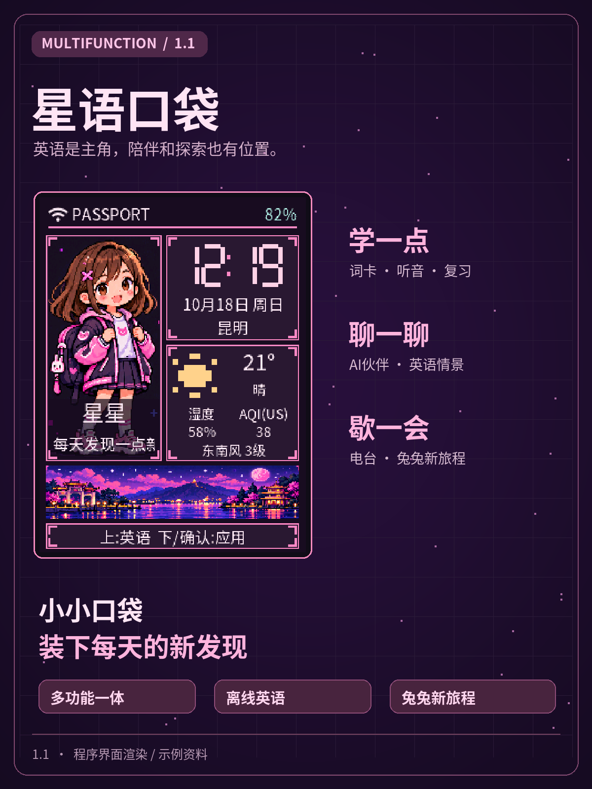
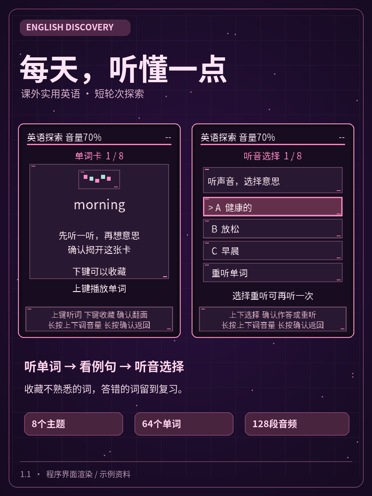
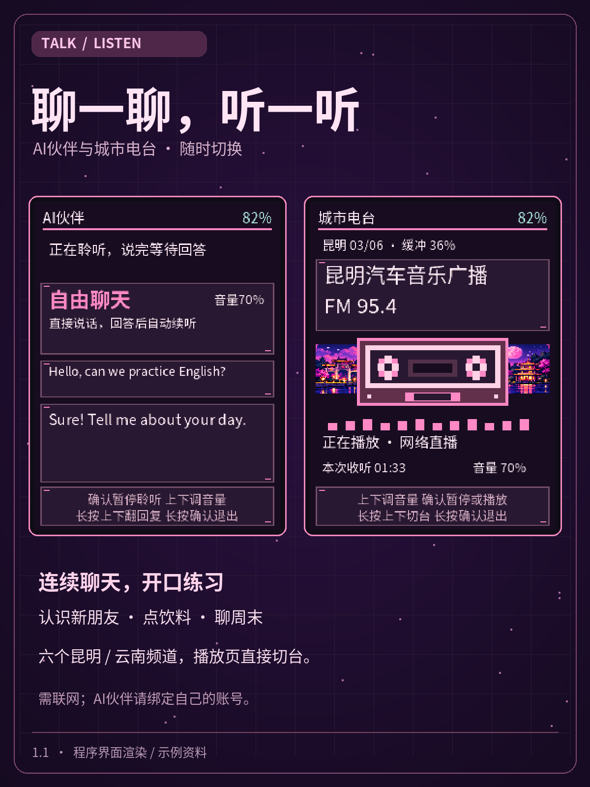
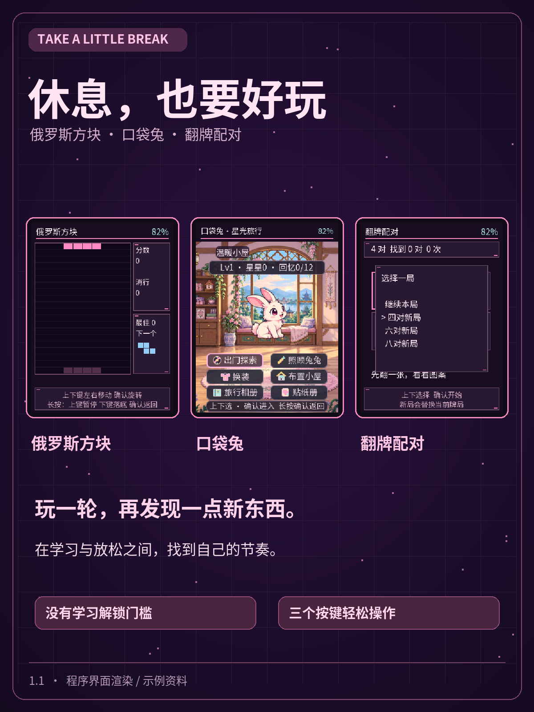
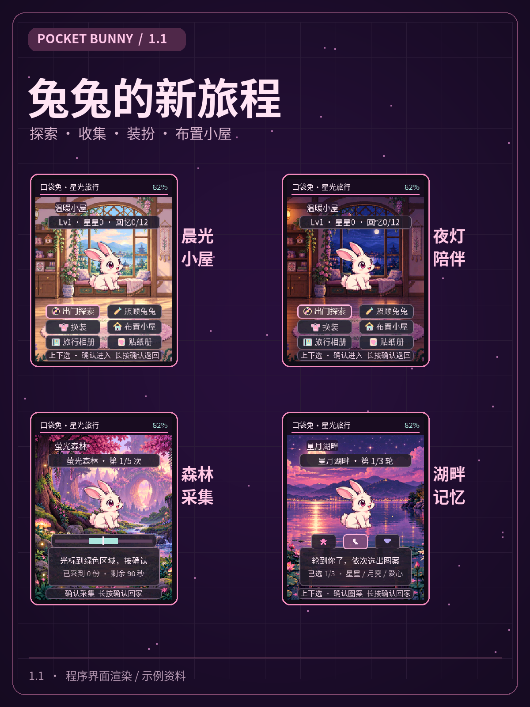

<strong>简体中文</strong> · <a href="README.md">English</a>

# 多功能-星语口袋 1.1

**英语是主角，娱乐也有位置。** 粉紫色的随身学习与娱乐小伙伴。

## 能玩什么

- **英语探索**：八个课外主题、64词、128段离线词音/例句；单词卡、听音选择、收藏/错词复习及混合例句挑战。
- **AI伙伴**：基于小智的连续自由聊天，以及认识新朋友、点饮料、聊周末三个英语情景/九张练习任务卡。
- **城市电台**：六个昆明/云南网络频道，在播放页直接切台。
- **轻松娱乐**：俄罗斯方块、翻牌配对，以及可探索、收集回忆和布置小屋的口袋兔。
- **专属工牌**：头像、昵称、签名、时钟、可改城市与联网天气。
- **自己配网**：设备扫描/密码输入/切网，手机网页设置可选。

| 英语探索 | AI伙伴与电台 |
| --- | --- |
|  |  |

查看 [1.1 更新说明](RELEASE_NOTES.zh_CN.md)。

图片使用原生界面渲染和通用示例资料，不是孩子照片或个人设备数据，也不是效果保证。

## 安装与开始

社区入口：[AI Passport 玩法社区](https://ai-passport.folotoy.cn/plays/1381/)，查找 **多功能-星语口袋**；社区发布/审核状态以页面为准。

也可下载本仓库的 [1.1合并固件](xingyu-pocket-1.1-full.bin)，通过[官方刷机工具](https://ai-passport.folotoy.cn/tools/web-flasher/)安装。完整刷新使用合并镜像从 `0x0` 写入，可能清除设备原有配置与记录；请先保存需要的资料。不要把应用单文件当作合并镜像。

安装后：首页上键进英语，下键/确认进菜单；上下选择、确认进入、长按确认逐层返回。联网、手机头像上传、小智独立配对及详细按键见[使用说明](MANUAL.zh_CN.md)。

**小智请绑定自己的账号。** 每台设备按当前屏幕显示的激活码在自己的小智账号中添加；不含作者的绑定信息、网络密码、个人头像或学习记录。天气/电台/AI需要联网，离线词卡和音频不依赖网络。

## 版本与边界

产品版本1.1，固件内部构建标识 `1.1.0-rc7`。对应已写入实机并获用户认可的版本，没有替换成另一份重新构建的固件。

- 1.1首批64词是课外补充，不是完整课程，也不承诺快速掌握。
- 语音对话和网络电台依赖第三方服务，电台可能缓冲，服务可用性会变化。
- 可选空气质量AQI可能显示`--`；有数值时为美标，温度/湿度/风独立显示。
- 照片提供清晰/柔绘等图像处理，不是生成式人像重绘。MUSE尚未实现。
- 已完成构建/主机检查及多轮实机反馈；完整长时间弱网/断电/连续对话压力测试仍未覆盖。

## 关于源码与隐私

本仓库是**展示、说明与固件分发仓库**，核心源码未公开。固件二进制不能保证无法逆向；此处不会上传源码归档、ELF/MAP调试文件、原始日志或设备存储备份。

校验值见[SHA256SUMS](SHA256SUMS)，公开包核对说明见[发布信息](release.json)。第三方代码/字体按各自许可保留声明，见[第三方声明](THIRD_PARTY_NOTICES.txt)；本项目不将全部固件重新声明为MIT开源。
